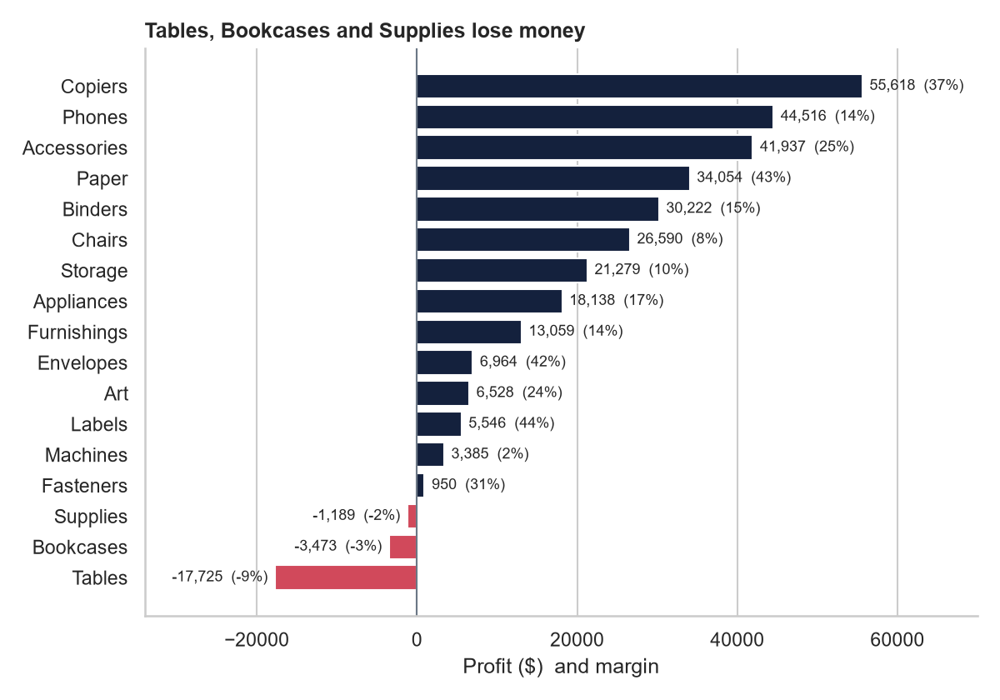

# Superstore Profitability Analysis (Python)

> The store sells $2.3M and keeps a 12.5% margin. Where does the profit go? A pandas / seaborn / SciPy notebook that finds the pricing decision behind most of the losses and quantifies it.

[Azərbaycanca](README.az.md) · [Open the notebook](notebooks/superstore_profitability.ipynb)


## Key findings

| Finding | Evidence |
|---|---|
| **Discounts above 20% destroy profit** | Margin: no discount 30%, up to 20% off 12 to 17%, 20-30% off -10%, 30-40% off -19%, over 50% off -119%. Of the lines with more than 20% off, 89% to 100% lose money |
| The damage is concentrated | 1,393 lines (13.9% of lines, 15.8% of sales) lose $135,376. The other 86% of lines earn $421,773. Without the deep-discount losses, profit would be 47% higher ($286k now) |
| Furniture is the problem category | Margin 2% vs 17% for Technology and Office Supplies. Tables lose $17.7k (-9%), Bookcases $3.5k, Supplies $1.2k |
| Loss-making states are heavy-discount states | 10 of 49 states lose $98k in total. Texas, Ohio, Pennsylvania and Illinois give 32% to 39% average discounts vs 16% nationally. Across states, average discount vs margin: Spearman -0.77 |
| Segment and ship mode are not the issue | Margins 12% to 14%; no significant difference in loss share by segment (p = 0.20) or margin by ship mode (p = 0.10) |
| Sub-category averages hide the effect | Binders have the highest average discount (37%) yet are profitable; the losses sit in their deep-discount lines |

**Recommendations:** cap discounts at 20% unless a manager approves; review Tables and Bookcases pricing; set regional targets on margin, not only on sales.
An illustration: if the deep-discount lines had been sold at 20% off with unchanged volume, profit would be about $506k instead of $286k. This is an optimistic upper bound (it assumes no lost sales).

## Charts

| | |
|---|---|
|  |  |
|  | |

## Data

9,994 order lines of a US retailer (sample course data, the well-known "Sample Superstore" file): segment, ship mode, region, state, city, category, sub-category, sales, quantity, discount, profit. `src/prepare_data.py` cleans it and runs six checks.

## Limitations

- Sample data with **no date and no order id**: the analysis shows where and at what price, not when. 17 exact duplicate lines are kept because without an order id they can be genuine repeat purchases.
- Correlation, not proof: discounts may have been given *because* items were not selling, so the data alone cannot show that discounts caused the losses. A controlled price test would.
- The 20% cap scenario ignores any loss of volume.

## How to run

```bash
pip install -r requirements.txt
python src/prepare_data.py "path/to/SampleSuperstore.csv"   # optional, data/superstore.csv is included
python src/build_notebook.py                                # executes the notebook and refreshes images/
```

## Author

**Alyaz Cabbarova**, aspiring data analyst, Baku.
[LinkedIn](https://www.linkedin.com/in/alyaz-cabbarova-450a6140b) · alyazcbbrv@gmail.com · [GitHub](https://github.com/alyazcbbrv-byte)

MIT License.
