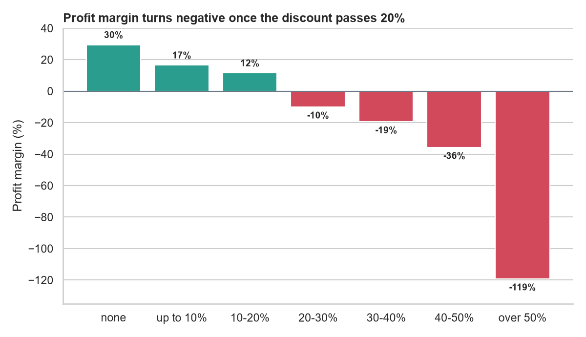
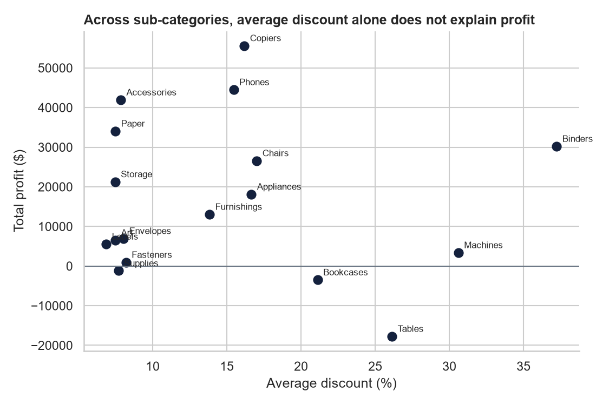
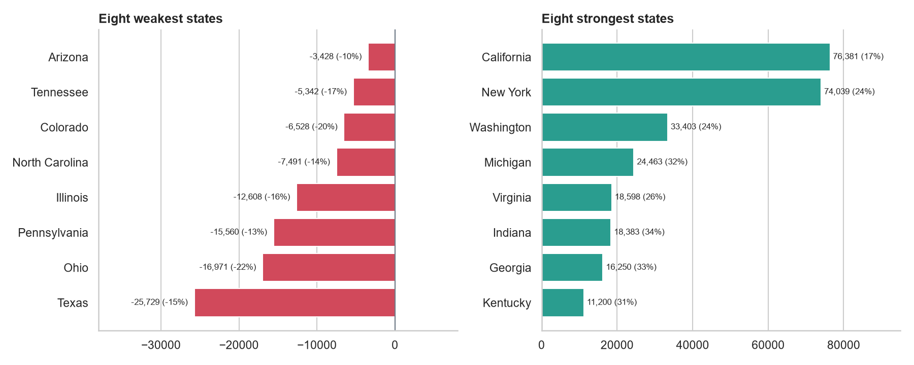

# Superstore mənfəət analizi (Python)

> Mağaza 2.3 milyon $ satır və 12.5% marja saxlayır. Mənfəət hara gedir? pandas / seaborn / SciPy notebook-u zərərlərin böyük hissəsinin arxasındakı qiymət qərarını tapır və ölçür.

[English](README.en.md) · [Notebook](notebooks/superstore_profitability.ipynb)



## Əsas nəticələr

| Tapıntı | Dəlil |
|---|---|
| **20%-dən çox endirim mənfəəti məhv edir** | Marja: endirimsiz 30%, 20%-ə qədər 12-17%, 20-30% endirim -10%, 30-40% -19%, 50%-dən çox -119%. 20%-dən çox endirimli sətirlərin 89-100%-i zərərlidir |
| Zərər cəmlənib | 1,393 sətir (sətirlərin 13.9%-i, satışın 15.8%-i) 135,376 $ itirir. Qalan 86% sətir 421,773 $ qazanır. Dərin endirim zərərləri olmasa mənfəət 47% yüksək olardı (indi 286 min $) |
| Problemli kateqoriya mebeldir | Marja 2%, Texnologiya və Ofis ləvazimatlarında 17%. Tables -17.7 min $ (-9%), Bookcases -3.5 min $ |
| Zərərli ştatlar çox endirim edilən ştatlardır | 49 ştatdan 10-u cəmi 98 min $ itirir. Texas, Ohio, Pennsylvania, Illinois-də orta endirim 32-39%, ölkə üzrə 16%. Ştatlar üzrə orta endirim və marja: Spearman -0.77 |
| Seqment və çatdırılma növü problem deyil | Marja 12-14%; seqment (p = 0.20) və çatdırılma (p = 0.10) üzrə statistik fərq yoxdur |
| Alt kateqoriya ortalaması təsiri gizlədir | Binders-də orta endirim ən yüksəkdir (37%), amma mənfəətlidir; zərər onların dərin endirimli sətirlərindədir |

**Tövsiyələr:** menecer təsdiqi olmadan endirimi 20%-lə məhdudlaşdırın; Tables və Bookcases qiymətlərini yenidən baxın; regional hədəfləri yalnız satışa yox, marjaya görə qoyun.
İllüstrasiya: dərin endirimli sətirlər həcm dəyişmədən 20% endirimlə satılsaydı, mənfəət 286 min $ əvəzinə təxminən 506 min $ olardı. Bu optimist yuxarı həddir (itirilən satışı nəzərə almır).

## Qrafiklər

| | |
|---|---|
|  |  |
|  | |

## Data və məhdudiyyətlər

9,994 sətirlik məşhur "Sample Superstore" nümunə datası. Tarix və sifariş nömrəsi yoxdur: analiz "harada və hansı qiymətlə" sualına cavab verir, "nə vaxt" sualına yox. 17 eyni sətir saxlanılıb. Korrelyasiya sübut deyil: endirimlər məhsul satılmadığı üçün verilmiş ola bilər. 20% limit ssenarisi satış itkisini nəzərə almır.

## Necə işlətməli

```bash
pip install -r requirements.txt
python src/build_notebook.py
```

## Müəllif

**Alyaz Cabbarova**, data analitik olmaq istəyən mütəxəssis, Bakı.
[LinkedIn](https://www.linkedin.com/in/alyaz-cabbarova-450a6140b) · alyazcbbrv@gmail.com · [GitHub](https://github.com/alyazcbbrv-byte)

MIT lisenziyası.
